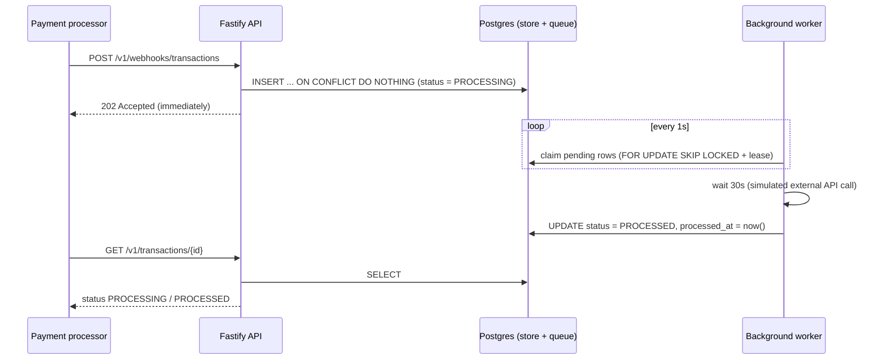

# Transaction Webhook Service

A service that receives transaction webhooks from payment processors (e.g. Razorpay), **acknowledges them immediately with `202 Accepted`**, and processes each transaction **reliably in the background** (30-second simulated external call). Duplicate webhooks are ignored safely, and no transaction is lost if the server crashes or restarts.

- **Live API:** `<add deployed URL here>`
- **Stack:** TypeScript · Node.js 22 · Fastify · PostgreSQL (Neon) · `pg`
- **Language note:** the assessment brief mentions Python; this solution is implemented in TypeScript.

---

## 1. How it works (overview)



The key idea: **the HTTP request does almost nothing** (validate + one database insert). All slow work happens in a worker that runs inside the same process. Postgres is both the permanent store and the job queue, so a pending transaction survives crashes and restarts.

### Request lifecycle

1. **Webhook arrives.** The body is validated (required fields, positive `amount`, 3-letter `currency`). Invalid payloads get `400`.
2. **Insert, don't process.** The transaction is inserted with `status = PROCESSING`. `transaction_id` is the primary key, so a duplicate insert is a no-op (`ON CONFLICT DO NOTHING`).
3. **Acknowledge.** The API returns `202 Accepted` right away, with the same response for first deliveries and duplicates. Processing time never affects the response time.
4. **Background worker** (polls every second):
   - **Claims** pending rows atomically with `FOR UPDATE SKIP LOCKED` and stamps a lease (`locked_at`). Multiple instances can run side by side without grabbing the same row.
   - **Waits 30 seconds** to simulate the external API call. Many transactions wait in parallel (up to `WORKER_CONCURRENCY`), so a burst does not queue behind 30-second waits.
   - **Finalises** the row: `status = PROCESSED`, `processed_at = now()`. The update is guarded by `WHERE status = 'PROCESSING'`, so a row can only be finalised once.
5. **Query.** `GET /v1/transactions/{id}` shows the current state: `PROCESSING` (with `processed_at: null`) and, after about 30 seconds, `PROCESSED`.

---

## 2. API reference

### `POST /v1/webhooks/transactions`: receive a transaction webhook

Request body (all fields required):

```json
{
  "transaction_id": "txn_abc123def456",
  "source_account": "acc_user_789",
  "destination_account": "acc_merchant_456",
  "amount": 1500,
  "currency": "INR"
}
```

| Rule | Detail |
|---|---|
| `transaction_id`, `source_account`, `destination_account` | non-empty strings |
| `amount` | number, greater than 0 |
| `currency` | string of exactly 3 characters |

Responses:

| Status | When | Body |
|---|---|---|
| `202 Accepted` | Valid webhook, new **or** duplicate | `{"status":"ACCEPTED","transaction_id":"txn_abc123def456"}` |
| `400 Bad Request` | Missing or invalid fields | Fastify validation error |

**Idempotency:** sending the same `transaction_id` any number of times (even concurrently) always returns `202` and results in exactly one transaction and one processing run. The first payload received wins; later payloads with the same id are ignored.

### `GET /`: health check

```json
{ "status": "HEALTHY", "current_time": "2026-11-01T06:30:38.530Z" }
```

### `GET /v1/transactions/{transaction_id}`: transaction status (for testing)

Returns an array with one object, as specified in the brief:

```json
[
  {
    "transaction_id": "txn_abc123def456",
    "source_account": "acc_user_789",
    "destination_account": "acc_merchant_456",
    "amount": 1500,
    "currency": "INR",
    "status": "PROCESSED",
    "created_at": "2026-11-01T06:31:11.940Z",
    "processed_at": "2026-11-01T06:31:43.331Z"
  }
]
```

| Field | Notes |
|---|---|
| `status` | `PROCESSING` → `PROCESSED` (or `FAILED` after `MAX_ATTEMPTS` failed attempts) |
| `processed_at` | `null` while still processing |
| Unknown id | `404 {"error":"Transaction not found"}` |

---

## 3. Data model

Single table, `transactions` (created automatically on startup):

| Column | Purpose |
|---|---|
| `transaction_id` (PK) | Idempotency key: duplicates cannot be inserted |
| `source_account`, `destination_account`, `amount` (`NUMERIC(18,2)`), `currency` | Webhook payload |
| `status` | `PROCESSING` / `PROCESSED` / `FAILED` |
| `created_at`, `processed_at` | Timing information |
| `locked_at` | Worker lease, used for crash recovery |
| `attempts` | Retry counter |

A partial index on `(status, created_at) WHERE status = 'PROCESSING'` keeps the worker's polling query fast.

---

## 4. Technical choices and why

| Decision | Reason |
|---|---|
| **Fastify** | Very low overhead on the hot webhook path; built-in JSON-schema validation. |
| **Postgres as store *and* queue** | One managed dependency, durable and transactional; no Redis or message broker to run. Appropriate for this scope. |
| **Primary key + `ON CONFLICT DO NOTHING`** | Idempotency enforced by the database itself, so it is race-free under concurrent duplicates. |
| **Insert-then-ack, no work in the request** | Guarantees the sub-500ms response regardless of processing time. The transaction is durably stored before we say `202`. |
| **`FOR UPDATE SKIP LOCKED` + lease** | Multiple workers/instances never claim the same row; if a worker dies, its lease expires and another picks the row up. |
| **Guarded final update** | `WHERE status = 'PROCESSING'` ensures a transaction is finalised at most once. |
| **Parallel waits (async sleep)** | Hundreds of in-flight 30-second waits cost almost nothing in Node, so throughput is not limited by the delay. |
| **Retries with a cap** | Failures release the lock and retry; after `MAX_ATTEMPTS` the row is marked `FAILED` instead of looping forever. |
| **Graceful shutdown** | On SIGTERM the server stops accepting work and drains in-flight transactions; anything unfinished is recovered via lease expiry. |
| **Deployed in the same region as the DB** | Keeps database round trips short so responses stay far below 500ms. |

### Reliability: what happens if the server dies mid-processing?

The row is already in Postgres with `status = PROCESSING`. After restart the worker finds it; once its lease (`LEASE_MS`, default 2 minutes) has expired it is claimed again and completed. Nothing is held only in memory.

---

## 5. Configuration (environment variables)

Copy `.env.example` to `.env`. `npm run dev` and `npm start` load it automatically. On a hosting platform, set these as environment variables instead.

| Variable | Default | Description |
|---|---|---|
| `DATABASE_URL` | **required** | Postgres connection string (`sslmode=require` for Neon) |
| `PORT` | `3000` | HTTP port |
| `PROCESSING_DELAY_MS` | `30000` | Simulated external API latency |
| `POLL_INTERVAL_MS` | `1000` | Worker polling interval |
| `WORKER_CONCURRENCY` | `200` | Max parallel transactions per instance |
| `LEASE_MS` | `120000` | Time after which a claimed row is considered abandoned |
| `MAX_ATTEMPTS` | `5` | Attempts before a transaction is marked `FAILED` |

---

## 6. Run locally

Requires Node.js **22.9+** and a Postgres database (a free [Neon](https://neon.tech) project works; Neon has a Singapore region).

```bash
npm install
cp .env.example .env        # then set DATABASE_URL
npm run dev                 # development, http://localhost:3000
# or
npm run build && npm start  # production build
```

The table is created automatically on startup. A Docker image is also available: `docker build -t webhook-service . && docker run -p 3000:3000 -e DATABASE_URL=... webhook-service`.

---

## 7. Test it

Replace `localhost:3000` with the live URL to test the deployed service.

```bash
# 1. Health
curl localhost:3000/

# 2. Single transaction: expect 202
curl -i -X POST localhost:3000/v1/webhooks/transactions \
  -H "content-type: application/json" \
  -d '{"transaction_id":"txn_test_001","source_account":"acc_user_789","destination_account":"acc_merchant_456","amount":1500,"currency":"INR"}'

# 3. Status right away (PROCESSING), then after ~30s (PROCESSED)
curl localhost:3000/v1/transactions/txn_test_001
sleep 31
curl localhost:3000/v1/transactions/txn_test_001

# 4. Duplicates: 5 parallel identical webhooks, all 202, one transaction
for i in 1 2 3 4 5; do
  curl -s -o /dev/null -w "%{http_code}\n" -X POST localhost:3000/v1/webhooks/transactions \
    -H "content-type: application/json" \
    -d '{"transaction_id":"txn_dup_001","source_account":"a","destination_account":"b","amount":100,"currency":"INR"}' &
done; wait
curl localhost:3000/v1/transactions/txn_dup_001
```

### Automated tests

Integration tests run against a real Postgres, with the processing delay shortened to 1 second:

```bash
DATABASE_URL="postgresql://..." npm test
```

They cover: health check, `202` and background processing, 10 concurrent duplicates producing one row, 100 parallel webhooks all under 500ms, recovery of an abandoned (expired-lease) row, and validation / `404` handling.

### Results from manual testing

| Check | Result |
|---|---|
| Webhook response | `202 Accepted` |
| Processing time | `PROCESSED` about 31s after creation |
| 5 parallel duplicates | five `202`s, a single stored transaction |
| 50 parallel webhooks | every response 0.27s–0.32s from a laptop calling a remote DB |

---

## 8. Project structure

```
src/
  server.ts   Entry point: wires DB, API and worker; graceful shutdown
  app.ts      Fastify app and the three endpoints
  worker.ts   Background processor: claim, wait, finalise, retry
  db.ts       Connection pool, schema migration, queries
  config.ts   Environment configuration
tests/
  api.test.ts Integration tests
Dockerfile    Container build
.env.example  Configuration template
```

---

## 9. Known limitations and production upgrades

- The worker runs inside the API process. For independent scaling, run it as a separate service (the code already supports multiple instances safely).
- At high volume, replace DB polling with a managed queue (SQS / Cloud Tasks / RabbitMQ) plus a dead-letter queue.
- Verify webhook signatures (e.g. Razorpay's `X-Razorpay-Signature`) and add rate limiting before using this with a real processor.
- The lease is time-based: if processing legitimately takes longer than `LEASE_MS`, it could be attempted twice. The guarded update still keeps the final state to a single processed transaction.
- A duplicate webhook with *different* field values is ignored; the first payload is kept.
