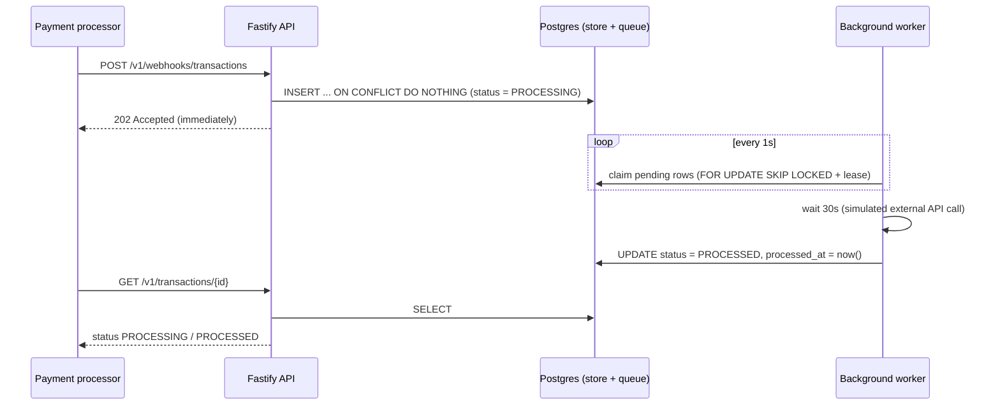

# Transaction Webhook Service

A service that receives transaction webhooks from payment processors (e.g. Razorpay), **acknowledges them immediately with `202 Accepted`**, and processes each transaction **reliably in the background** (30-second simulated external call). Duplicate webhooks are ignored safely, and no transaction is lost if the server crashes or restarts.

- **Live API:** https://transaction-webhook-service-mkr4.onrender.com
- **Stack:** TypeScript · Node.js 22 · Fastify · PostgreSQL (Neon) · `pg`
- **Hosting:** the API is deployed on **Render**; the database is a managed **Neon** Postgres (Singapore, `ap-southeast-1`).
- **Language note:** the assessment brief mentions Python; this solution is implemented in TypeScript.

> ⏳ **Heads-up: the first request may be slow.** The API is hosted on Render. Render spins down idle instances on its free tier, so the **first request after a period of inactivity can take up to about a minute** while the service wakes up. Once it is awake, responses are fast (the webhook returns `202` well under 500ms). If the first call looks stuck, just wait for it to finish, or send `GET /` first to warm the service up, then run the tests below.

---

## Quick test for reviewers

Run against the live API (about 1 minute, needs `curl`; works in bash / Git Bash):

```bash
BASE=https://transaction-webhook-service-mkr4.onrender.com
ID=txn_review_$(date +%s)          # unique id so the test can be repeated
H='content-type: application/json'
BODY="{\"transaction_id\":\"$ID\",\"source_account\":\"acc_user_789\",\"destination_account\":\"acc_merchant_456\",\"amount\":1500,\"currency\":\"INR\"}"

# 1. Health check (also wakes the service if it was asleep)
curl -s $BASE/

# 2. Send the webhook: expect HTTP 202 and a fast response
curl -s -i -w "\nTIME: %{time_total}s\n" -X POST $BASE/v1/webhooks/transactions -H "$H" -d "$BODY"

# 3. Send the SAME webhook 3 more times: all 202, still only one transaction
for i in 1 2 3; do curl -s -o /dev/null -w "%{http_code}\n" -X POST $BASE/v1/webhooks/transactions -H "$H" -d "$BODY"; done

# 4. Status right away: PROCESSING, processed_at is null
curl -s $BASE/v1/transactions/$ID

# 5. Status after ~31s: PROCESSED, processed_at is about 30s after created_at
sleep 31
curl -s $BASE/v1/transactions/$ID
```

Expected: step 2 returns `202`, step 3 returns three more `202`s, step 4 returns one object with `"status":"PROCESSING"`, step 5 returns `"status":"PROCESSED"`. More test commands (validation, 404, load) are in [section 8](#8-test-it).

---

## 1. How it works (overview)



The key idea: **the HTTP request does almost nothing** (validate + one database insert). All slow work happens in a worker that runs inside the same process. Postgres is both the permanent store and the job queue, so a pending transaction survives crashes and restarts.

### Request lifecycle

1. **Webhook arrives.** The body is validated (required fields, positive `amount`, 3-letter `currency`). Invalid payloads get `400`.
2. **Insert, don't process.** The transaction is inserted with `status = PROCESSING`. `transaction_id` is the primary key, so a duplicate insert is a no-op (`ON CONFLICT DO NOTHING`).
3. **Acknowledge.** The API returns `202 Accepted` right away, with the same response for first deliveries and duplicates. Processing time never affects the response time.
4. **Background worker** (polls every second):
   - **Claims** pending rows atomically with `FOR UPDATE SKIP LOCKED` and stamps a lease (`locked_at`). Multiple instances can run side by side without grabbing the same row.
   - **Waits 30 seconds** to simulate the external API call. Many transactions wait in parallel (up to `WORKER_CONCURRENCY`), so a burst does not queue behind 30-second waits.
   - **Finalises** the row: `status = PROCESSED`, `processed_at = now()`. The update is guarded by `WHERE status = 'PROCESSING'`, so a row can only be finalised once.
5. **Query.** `GET /v1/transactions/{id}` shows the current state: `PROCESSING` (with `processed_at: null`) and, after about 30 seconds, `PROCESSED`.

---

## 2. API reference

Base URL: `https://transaction-webhook-service-mkr4.onrender.com` (or `http://localhost:3000` locally).

### `POST /v1/webhooks/transactions`: receive a transaction webhook

Request body (all fields required):

```json
{
  "transaction_id": "txn_abc123def456",
  "source_account": "acc_user_789",
  "destination_account": "acc_merchant_456",
  "amount": 1500,
  "currency": "INR"
}
```

| Field | Rule |
|---|---|
| `transaction_id`, `source_account`, `destination_account` | non-empty strings, up to 128 characters |
| `amount` | number, greater than 0 (numeric strings such as `"100"` are coerced to a number; non-numeric strings are rejected) |
| `currency` | string of exactly 3 characters |

Unknown extra fields are ignored.

Responses:

| Status | When | Body |
|---|---|---|
| `202 Accepted` | Valid webhook, new **or** duplicate | `{"status":"ACCEPTED","transaction_id":"txn_abc123def456"}` |
| `400 Bad Request` | Missing or invalid fields | Fastify validation error, e.g. `{"statusCode":400,"code":"FST_ERR_VALIDATION","error":"Bad Request","message":"body must have required property 'currency'"}` |

**Idempotency:** sending the same `transaction_id` any number of times (even concurrently) always returns `202` and results in exactly one transaction and one processing run. The first payload received wins; later payloads with the same id are ignored.

### `GET /`: health check

```json
{ "status": "HEALTHY", "current_time": "2026-11-01T06:30:38.530Z" }
```

`current_time` is the server time in ISO-8601 UTC.

### `GET /v1/transactions/{transaction_id}`: transaction status (for testing)

Returns an array with one object, as specified in the brief:

```json
[
  {
    "transaction_id": "txn_abc123def456",
    "source_account": "acc_user_789",
    "destination_account": "acc_merchant_456",
    "amount": 1500,
    "currency": "INR",
    "status": "PROCESSED",
    "created_at": "2026-11-01T06:31:11.940Z",
    "processed_at": "2026-11-01T06:31:43.331Z"
  }
]
```

| Field | Notes |
|---|---|
| `status` | `PROCESSING` → `PROCESSED` (or `FAILED` after `MAX_ATTEMPTS` failed attempts) |
| `processed_at` | `null` while still processing |
| Unknown id | `404 {"error":"Transaction not found"}` |

---

## 3. Data model

Single table, `transactions` (created automatically on startup):

| Column | Purpose |
|---|---|
| `transaction_id` (PK) | Idempotency key: duplicates cannot be inserted |
| `source_account`, `destination_account`, `amount` (`NUMERIC(18,2)`), `currency` | Webhook payload |
| `status` | `PROCESSING` / `PROCESSED` / `FAILED` |
| `created_at`, `processed_at` | Timing information |
| `locked_at` | Worker lease, used for crash recovery |
| `attempts` | Retry counter |

A partial index on `(status, created_at) WHERE status = 'PROCESSING'` keeps the worker's polling query fast.

---

## 4. Technical choices and why

| Decision | Reason |
|---|---|
| **Fastify** | Very low overhead on the hot webhook path; built-in JSON-schema validation. |
| **Postgres as store *and* queue** | One managed dependency, durable and transactional; no Redis or message broker to run. Appropriate for this scope. |
| **Primary key + `ON CONFLICT DO NOTHING`** | Idempotency enforced by the database itself, so it is race-free under concurrent duplicates. |
| **Insert-then-ack, no work in the request** | Guarantees the sub-500ms response regardless of processing time. The transaction is durably stored before we say `202`. |
| **`FOR UPDATE SKIP LOCKED` + lease** | Multiple workers/instances never claim the same row; if a worker dies, its lease expires and another picks the row up. |
| **Guarded final update** | `WHERE status = 'PROCESSING'` ensures a transaction is finalised at most once. |
| **Parallel waits (async sleep)** | Hundreds of in-flight 30-second waits cost almost nothing in Node, so throughput is not limited by the delay. |
| **Retries with a cap** | Failures release the lock and retry; after `MAX_ATTEMPTS` the row is marked `FAILED` instead of looping forever. |
| **Graceful shutdown** | On SIGTERM the server stops accepting work and drains in-flight transactions; anything unfinished is recovered via lease expiry. |
| **App and database in the same region** | Keeps database round trips short so responses stay far below 500ms. |

### Reliability: what happens if the server dies mid-processing?

The row is already in Postgres with `status = PROCESSING`. After restart the worker finds it; once its lease (`LEASE_MS`, default 2 minutes) has expired it is claimed again and completed. Nothing is held only in memory.

---

## 5. Configuration (environment variables)

Copy `.env.example` to `.env`. `npm run dev` and `npm start` load it automatically. On a hosting platform, set these as environment variables instead.

| Variable | Default | Description |
|---|---|---|
| `DATABASE_URL` | **required** | Postgres connection string (`sslmode=require` for Neon) |
| `PORT` | `3000` | HTTP port (hosting platforms inject this) |
| `PROCESSING_DELAY_MS` | `30000` | Simulated external API latency |
| `POLL_INTERVAL_MS` | `1000` | Worker polling interval |
| `WORKER_CONCURRENCY` | `200` | Max parallel transactions per instance |
| `LEASE_MS` | `120000` | Time after which a claimed row is considered abandoned |
| `MAX_ATTEMPTS` | `5` | Attempts before a transaction is marked `FAILED` |

---

## 6. Run locally

Requires Node.js **22.9+** and a Postgres database (a free [Neon](https://neon.tech) project works).

```bash
npm install
cp .env.example .env        # then set DATABASE_URL
npm run dev                 # development, http://localhost:3000
# or
npm run build && npm start  # production build
```

The table is created automatically on startup. A Docker image is also available: `docker build -t webhook-service . && docker run -p 3000:3000 -e DATABASE_URL=... webhook-service`.

---

## 7. Deployment

| Part | Where | Notes |
|---|---|---|
| API + worker | **Render** web service (Node) | Build: `npm install --include=dev; npm run build` · Start: `npm start` |
| Database | **Neon** Postgres, Singapore (`ap-southeast-1`) | Pooled connection string, `sslmode=require` |

Environment variables set on Render: `DATABASE_URL` and `NODE_VERSION=22`. The database schema is created automatically on first start, so no manual migration step is needed.

**Cold starts:** on Render's free tier an idle instance is spun down and the first request after that can take up to about a minute. This only affects the first call after inactivity. Because the background worker lives in the same process, a transaction received while the service is awake is processed normally.

---

## 8. Test it

Set `BASE` to the live URL, or to `http://localhost:3000` for a local run. The `RUN` suffix keeps ids unique so tests can be repeated.

```bash
BASE=https://transaction-webhook-service-mkr4.onrender.com
RUN=$(date +%s)
H='content-type: application/json'

# Health
curl -s $BASE/

# Webhook: expect 202
curl -s -i -w "\nTIME: %{time_total}s\n" -X POST $BASE/v1/webhooks/transactions -H "$H" \
  -d "{\"transaction_id\":\"txn_${RUN}_a\",\"source_account\":\"acc_user_789\",\"destination_account\":\"acc_merchant_456\",\"amount\":1500,\"currency\":\"INR\"}"

# Status: PROCESSING now, PROCESSED after ~30s
curl -s $BASE/v1/transactions/txn_${RUN}_a
sleep 31
curl -s $BASE/v1/transactions/txn_${RUN}_a

# Duplicates: 10 parallel identical webhooks, all 202, exactly one transaction
for i in $(seq 1 10); do
  curl -s -o /dev/null -w "%{http_code} " -X POST $BASE/v1/webhooks/transactions -H "$H" \
    -d "{\"transaction_id\":\"txn_${RUN}_dup\",\"source_account\":\"a\",\"destination_account\":\"b\",\"amount\":100,\"currency\":\"INR\"}" &
done; wait; echo
curl -s $BASE/v1/transactions/txn_${RUN}_dup | grep -o transaction_id | wc -l      # expect 1

# Validation: expect 400
curl -s -o /dev/null -w "%{http_code}\n" -X POST $BASE/v1/webhooks/transactions -H "$H" \
  -d '{"transaction_id":"txn_bad","source_account":"a"}'

# Unknown id: expect 404
curl -s -w "\n%{http_code}\n" $BASE/v1/transactions/txn_does_not_exist
```

### Automated tests

Integration tests run against a real Postgres, with the processing delay shortened to 1 second:

```bash
DATABASE_URL="postgresql://..." npm test
```

They cover: health check, `202` and background processing, 10 concurrent duplicates producing one row, 100 parallel webhooks all under 500ms, recovery of an abandoned (expired-lease) row, and validation / `404` handling.

### Results from manual testing (local server, remote Neon database)

| Check | Result |
|---|---|
| Health check | `HEALTHY` with UTC timestamp |
| Webhook response | `202 Accepted` |
| Processing time | `PROCESSED` about 30.6s after creation |
| Sequential and 10 parallel duplicates | all `202`, a single stored transaction |
| Duplicate with different data | first payload kept, later one ignored |
| 50 parallel webhooks | every response 0.27s–0.32s (laptop calling a remote database) |
| Invalid payloads (missing field, negative amount, bad currency, non-numeric amount) | `400` |
| Unknown transaction id | `404` |

---

## 9. Project structure

```
src/
  server.ts   Entry point: wires DB, API and worker; graceful shutdown
  app.ts      Fastify app and the three endpoints
  worker.ts   Background processor: claim, wait, finalise, retry
  db.ts       Connection pool, schema migration, queries
  config.ts   Environment configuration
tests/
  api.test.ts Integration tests
Dockerfile    Container build
.env.example  Configuration template
```

---

## 10. Known limitations and production upgrades

- The worker runs inside the API process. For independent scaling, run it as a separate service (the code already supports multiple instances safely).
- At high volume, replace DB polling with a managed queue (SQS / Cloud Tasks / RabbitMQ) plus a dead-letter queue.
- Verify webhook signatures (e.g. Razorpay's `X-Razorpay-Signature`) and add rate limiting before using this with a real processor.
- The lease is time-based: if processing legitimately takes longer than `LEASE_MS`, it could be attempted twice. The guarded update still keeps the final state to a single processed transaction.
- A duplicate webhook with *different* field values is ignored; the first payload is kept.
- Free-tier hosting spins down when idle (see [Deployment](#7-deployment)); an always-on instance removes the cold start.
